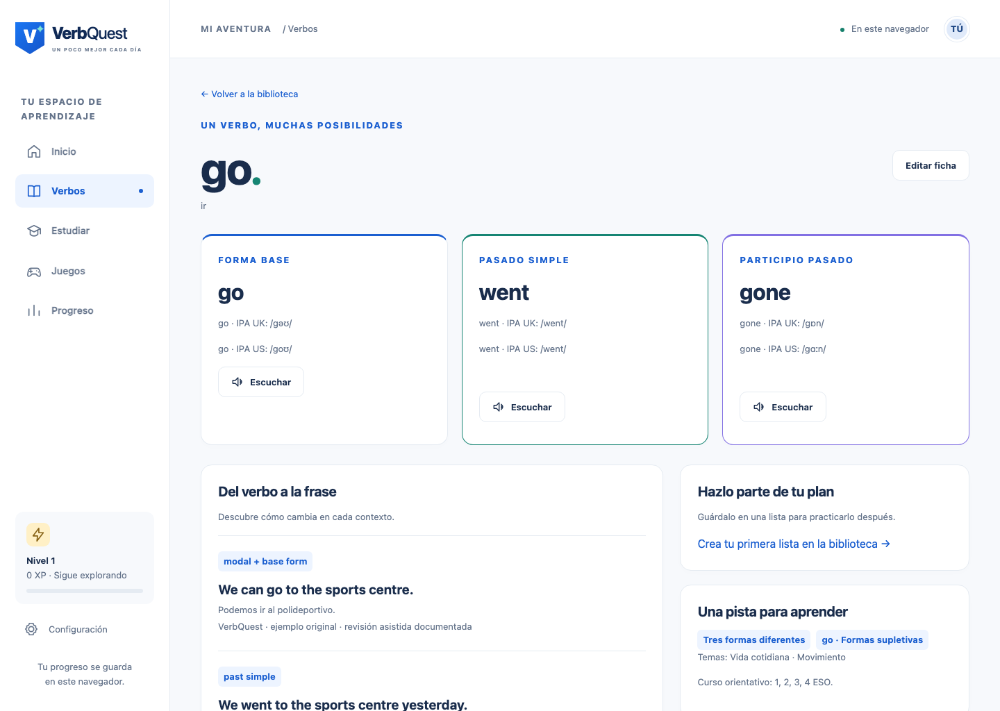

# VerbQuest

Aplicación educativa para practicar verbos irregulares en inglés, con interfaz en español y contenidos orientados a la ESO. Incluye catálogo editable, planes, cinco juegos y repaso espaciado por habilidad.

**Estado:** MVP local para navegador. Los datos se guardan en el dispositivo; no se necesitan cuentas, claves API ni un backend. Las recomendaciones por curso son orientativas y editables, no un listado curricular oficial.

## Contenido

- [Inicio rápido](#inicio-rápido)
- [Acceso local y desde la red](#acceso-local-y-desde-la-red)
- [Primeros pasos y juegos](#primeros-pasos-y-juegos)
- [Cómo se mide el aprendizaje](#cómo-se-mide-el-aprendizaje)
- [Datos y copias de seguridad](#datos-y-copias-de-seguridad)
- [Editar, importar y exportar verbos](#editar-importar-y-exportar-verbos)
- [Audio y pronunciación](#audio-y-pronunciación)
- [PWA y uso sin conexión](#pwa-y-uso-sin-conexión)
- [Comandos y comprobaciones](#comandos-y-comprobaciones)
- [Organización del proyecto](#organización-del-proyecto)
- [Contenido y revisión editorial](#contenido-y-revisión-editorial)
- [Compilación y alojamiento](#compilación-y-alojamiento)
- [Resolución de problemas](#resolución-de-problemas)
- [Documentación y límites](#documentación-y-límites)

## Inicio rápido

### Requisitos

- **Node.js 24.x**, conforme a `.nvmrc` y `package.json`.
- npm, incluido con Node.js. El entorno de verificación utiliza Node 24.12.0 y npm 11.6.2.
- Un navegador moderno con JavaScript e IndexedDB habilitados.

Desde la raíz del proyecto:

```sh
npm ci
npm run dev
```

Abre la dirección **Local** que muestre Vite. El puerto configurado es **3000**; por ejemplo, `http://localhost:3000`. Detén el servidor con `Ctrl+C`.

Si utilizas nvm, ejecuta `nvm use` antes de instalar las dependencias. No se requiere configurar un archivo `.env`, una base de datos externa ni credenciales.

`npm ci` instala las versiones fijadas en `package-lock.json`. Utilízalo también después de actualizar las dependencias del proyecto.

## Acceso local y desde la red

El script de desarrollo escucha en `0.0.0.0`, por lo que Vite puede anunciar varias direcciones:

| Dirección                                         | Uso                                                                             |
| ------------------------------------------------- | ------------------------------------------------------------------------------- |
| `http://localhost:3000` o `http://127.0.0.1:3000` | Navegador del equipo que ejecuta el servidor                                    |
| `http://192.168.1.50:3000` — IP de ejemplo        | Otro dispositivo con acceso a la misma red; utiliza la IP real que indique Vite |
| Dirección de una interfaz VPN                     | Equipos con acceso a esa VPN y al equipo servidor                               |

Para abrirla desde un móvil u otro ordenador, mantén el servidor encendido y utiliza su dirección de red, **no localhost**: localhost siempre se refiere al dispositivo desde el que se abre el navegador. La conectividad también depende de la ruta de red y del cortafuegos del equipo. Una dirección anunciada por Vite no equivale a publicar la aplicación en Internet.

La aplicación permite trabajar por **HTTP de red**, incluida la creación de perfil, listas, planes y sesiones. La instalación PWA y el service worker requieren **HTTPS o localhost**.

### Cambiar o fijar el puerto

```sh
npm run dev -- --port 3001 --strictPort
```

Sin `--strictPort`, Vite puede escoger otro puerto si el configurado está ocupado. Utiliza siempre la URL de la terminal.

**Mantén una dirección estable para estudiar.** `localhost`, `127.0.0.1`, una IP de red, otro puerto o HTTPS constituyen orígenes distintos y no comparten automáticamente los datos del navegador. Para trasladarlos, utiliza una copia completa.

## Primeros pasos y juegos

1. Abre **Verbos** y busca una forma o un significado: buscar `went` encuentra `go`.
2. Consulta la ficha, sus variantes, ejemplos y transcripciones disponibles. Combina filtros por curso, relación de formas y familias, tema o aprendizaje.
3. Marca varios verbos y pulsa **Guardar selección** para crear una lista.
4. En **Estudiar**, utiliza una de las nueve plantillas o configura un plan. Desde **Juegos**, elige biblioteca, lista, plan guardado o selección manual.
5. Revisa las habilidades y próximas fechas en **Progreso**. Puedes pausar una sesión y continuarla después.

| Actividad         | Qué practica                                                       |
| ----------------- | ------------------------------------------------------------------ |
| Flashcards        | Recuerdo y autoevaluación después de revelar la respuesta          |
| Emparejar formas  | Reconocimiento mediante varias asociaciones, con botones o teclado |
| Quiz de verbos    | Reconocimiento con opciones de respuesta                           |
| Audio Detective   | Escucha; ofrece alternativa visual si no puedes utilizar audio     |
| Completa la frase | Uso del verbo en un contexto escrito                               |

Las sesiones de estudio también incorporan ejercicios de respuesta escrita. Los temas claro/oscuro, movimiento reducido, voz y duración se ajustan desde **Configuración**.



## Cómo se mide el aprendizaje

Reconocimiento, memoria, escucha, escritura y contexto se evalúan por separado. Pronunciación aparece **sin evaluar**. Los sellos de actividad y los puntos XP no sustituyen a las evidencias de aprendizaje.

- Los intervalos predeterminados son **1, 3, 7 y 14 días de calendario**, según la zona horaria configurada.
- Una pareja verbo/habilidad puede avanzar como máximo una vez al día y cuando corresponda su repaso. Practicar antes sigue siendo posible, pero no adelanta el ciclo.
- Dominar requiere al menos cuatro avances aptos y cobertura de base, pasado y participio; `was` y `were` tienen objetivos separados. Contexto exige evidencia escrita sin opciones.
- Las pistas, respuestas reveladas y autoevaluaciones no acreditan dominio objetivo. Acertar un quiz no mejora automáticamente la escritura.
- Un error objetivo reinicia el ciclo de esa habilidad y programa refuerzo para el día siguiente.
- Cambiar formas o ejemplos relevantes reinicia la evidencia afectada sin borrar el historial. Una pregunta pendiente sobre contenido antiguo no acredita las formas nuevas.

Las reglas completas están en [Reglas de aprendizaje](docs/learning-rules.md).

## Datos y copias de seguridad

Los datos se guardan en **IndexedDB de ese navegador y origen**: perfil, catálogo local, listas, planes, sesiones, intentos, progreso, ajustes y recompensas. No hay sincronización entre dispositivos ni recuperación mediante una cuenta.

Cerrar el servidor no borra esos datos. Borrar los datos del sitio, cambiar de perfil de navegador o utilizar otra dirección puede hacer que dejen de estar disponibles. El navegador también puede retirar almacenamiento; conserva copias fuera de él.

### Guardar una copia

1. Abre **Configuración**.
2. Pulsa **Exportar mis datos**.
3. Guarda el archivo JSON descargado fuera del almacenamiento del navegador.

También puedes usar **Descargar copia completa** en **Importar / exportar**.

### Restaurar o cambiar de dispositivo

1. Exporta una copia completa en el navegador de origen.
2. Abre VerbQuest en el navegador o dispositivo de destino.
3. Ve a **Configuración → Restaurar una copia** y selecciona **Restaurar copia JSON** en la pantalla de importación/exportación.
4. Revisa el resumen. Puedes descargar una copia de los datos actuales antes de continuar.
5. Confirma el reemplazo en el segundo paso.

**Restaurar sustituye todos los datos locales de ese origen; no mezcla perfiles.** La copia se valida antes de modificar el almacenamiento. El límite de archivo es 25 MiB.

### Reiniciar no es lo mismo que borrar

- **Reiniciar progreso** conserva catálogo, listas, planes y preferencias; elimina sesiones, intentos, progreso y recompensas.
- **Borrar todos los datos locales** restablece la instalación local.

Ambas acciones requieren dos pasos de confirmación y permiten descargar una copia antes.

## Editar, importar y exportar verbos

En **Verbos**, activa el interruptor **Editar catálogo** para mostrar el lápiz y la papelera de cada fila. El lápiz abre la ficha para editarla; el botón **+**, junto al interruptor, crea un verbo nuevo. Al desactivar el modo de edición se ocultan estas acciones, conservando la búsqueda y los filtros. También puedes utilizar **Editar ficha** dentro de un verbo. El editor avanzado JSON permite trabajar con variantes, fuentes, ejemplos y otros campos. El modo de edición local no es un sistema de permisos de profesor/alumno.

En **Filtros → Relación de formas y familias**, elegir una relación selecciona todas sus familias. Puedes desmarcar familias para afinar la búsqueda o marcar varias. La casilla **Todas las familias** indica la selección parcial y permite volver a seleccionarlas todas; si no queda ninguna marcada, no habrá resultados. **Quitar filtro de familias** restaura todas las familias de la relación sin borrar la búsqueda ni los otros filtros. **Limpiar filtros** reinicia los filtros y conserva el texto de búsqueda. Las familias se agrupan según la clasificación de cada verbo: algunas pertenecen a más de una relación. Las etiquetas generales antiguas se conservan en los datos, pero este control muestra la familia detallada cuando está disponible.

El altavoz de cada fila reproduce en orden la base, el pasado y el participio con tus ajustes de voz, dialecto, velocidad y volumen. Pulsarlo de nuevo detiene el audio; cambiar de verbo cancela la secuencia anterior. Para **read** se usan ejemplos revisados en contexto para distinguir sus pronunciaciones. Se utiliza voz sintética del navegador; escuchar no añade XP ni acredita dominio.

Archivar un verbo muestra su impacto y conserva referencias e historial. Para recuperarlo, activa **Ver archivados** y el modo de edición en la biblioteca y pulsa el icono de restaurar, o abre su ficha.

En **Importar / exportar** puedes previsualizar archivos, mapear columnas CSV y decidir si un duplicado se omite, actualiza o crea con otro identificador. La previsualización no aplica los cambios: debes confirmarlos.

| Formato             | Qué conserva                                                | Uso recomendado                                        |
| ------------------- | ----------------------------------------------------------- | ------------------------------------------------------ |
| JSON de catálogo    | Fichas, variantes, IPA, fuentes, ejemplos y clasificaciones | Trasladar o editar contenido; no incluye progreso      |
| CSV de catálogo     | Campos básicos de las fichas; pierde metadatos              | Trabajar con hojas de cálculo                          |
| Copia completa JSON | Catálogo local y datos de estudio del perfil                | Seguridad, restauración y cambio de dispositivo/origen |

Ejemplo mínimo de CSV:

```csv
id,base,past_simple,past_participle,meanings_es
go,go,went,gone,ir
```

Las variantes se separan con `/` y los significados o cursos con `;`. El CSV admite BOM, comillas, saltos de línea y delimitadores habituales. Las entradas sin estado editorial se importan como pendientes de revisión; no se convierten automáticamente en contenido evaluable. Si `go` ya existe, la vista previa pedirá resolver el duplicado.

El catálogo importado admite hasta **5 MiB**, **10.000 filas** y **20.000 caracteres por campo**. Para conservar todos los metadatos utiliza JSON. Los detalles están en [Formatos y copias](docs/data-formats.md).

## Audio y pronunciación

La reproducción utiliza síntesis de voz del navegador/sistema. No se usa micrófono ni se redistribuyen grabaciones de terceros.

- Puedes configurar dialecto, voz, volumen y velocidad. La voz disponible depende del dispositivo y puede necesitar Internet.
- La interfaz identifica la voz/dialecto utilizados y avisa de alternativas. No garantiza que todos los dispositivos dispongan de voces UK y US.
- Si falta audio, Audio Detective permite continuar con una alternativa de escritura. Esa respuesta **no cuenta como escucha**.
- **Modo IPA estricto** (en Configuración, desactivado por defecto): al activarlo y guardar las preferencias, las fichas muestran IPA por forma, variante y dialecto, sus fuentes y los avisos de revisión; el filtro solo admite transcripciones validadas. Desactivado, las fichas ocultan esa información y sus avisos; el filtro usa las transcripciones disponibles como agrupación orientativa, sin convertirlas en validadas. Es compatible con preferencias guardadas antes de existir este ajuste.
- Los campos **Terminación escrita (pasado)** y **Sonido final** ofrecen sugerencias desplegables y permiten escribir libremente. Ejemplos escritos: `ought`, `ew`, `ent`; ejemplos fonéticos: `/t/`, `/d/`, `/n/`. El sonido final admite también `t` o `t/`. Comienza en **participio pasado**, donde estas tres terminaciones agrupan 98 de los 120 verbos del catálogo actual en UK sin modo estricto. Puedes cambiar forma y dialecto; los resultados dependen de los datos disponibles y del modo elegido. No se inventan sonidos para verbos sin transcripción.
- `read` aislado se excluye de síntesis evaluable: su escritura no basta para distinguir la pronunciación de la base y el pasado.

La transcripción IPA, la voz sintética y la evaluación del alumno son recursos distintos; disponer de uno no valida los otros.

## PWA y uso sin conexión

La PWA se prepara en la **compilación de producción**, no mediante `npm run dev`.

```sh
npm run build
npm run preview -- --port 4173 --strictPort
```

Abre `http://127.0.0.1:4173`, realiza una primera carga completa con conexión y espera a que se prepare la caché. Después podrás utilizar las funciones de texto, navegar por las fichas y guardar datos sin conexión. En navegadores compatibles, utiliza su opción de instalar la aplicación.

En una dirección de red por HTTP puedes usar la aplicación mientras el servidor sea accesible, pero el service worker no estará disponible. Para PWA/offline desde otros dispositivos se necesita un alojamiento HTTPS. El audio tampoco queda garantizado offline: algunas voces son remotas.

Las actualizaciones se anuncian y requieren una acción explícita. Pausa o termina la sesión antes de activar una actualización. Instalar la PWA no sustituye a guardar copias de seguridad.

Más información en [Offline y almacenamiento](docs/offline-and-storage.md).

## Comandos y comprobaciones

Ejecuta los comandos desde la raíz del repositorio.

| Comando                     | Función                                                    |
| --------------------------- | ---------------------------------------------------------- |
| `npm ci`                    | Instala las dependencias fijadas en el lockfile            |
| `npm run dev`               | Servidor Vite de desarrollo, puerto 3000 y acceso de red   |
| `npm run typecheck`         | Comprueba los tipos sin emitir archivos                    |
| `npm test`                  | Ejecuta las pruebas unitarias y de integración con Vitest  |
| `npm run test:watch`        | Ejecuta Vitest en modo de observación                      |
| `npm run content:check`     | Audita el catálogo activo y su revisión editorial          |
| `npm run build`             | Comprueba tipos y genera `dist`, manifest y service worker |
| `npm run preview`           | Sirve `dist` localmente para revisión                      |
| `npm run test:e2e`          | Construye y prueba la aplicación con Playwright            |
| `npm run test:dev-hmr`      | Comprueba la recarga en caliente con Vite y Chromium        |
| `npm run benchmark:catalog` | Mide consultas sobre 10.000 entradas sintéticas de prueba  |

### Preparar los navegadores de pruebas

Después de instalar las dependencias, instala los motores que usa Playwright:

```sh
npx playwright install chromium firefox webkit
```

En un entorno Linux que necesite bibliotecas del sistema puedes utilizar `npx playwright install --with-deps chromium firefox webkit`.

### Comprobación completa

```sh
npm run typecheck
npm test
npm run content:check
npm run build
npm run test:e2e
```

Playwright arranca su propio servidor de producción en **4173**, por lo que ese puerto debe estar libre. La configuración ejecuta Chromium, Firefox y WebKit con un trabajador. También puedes ejecutar una prueba o motor concreto:

```sh
npm run test:e2e -- --project=chromium e2e/network-http.spec.ts
npm test -- src/shared/identity/create-id.test.ts
```

Los fallos E2E generan evidencias en `test-results/`, incluidas trazas cuando corresponda. El benchmark es orientativo y depende del equipo; no es una garantía de rendimiento de todos los dispositivos.

Última verificación registrada, **31/10/2026**: 111 pruebas unitarias/integración y 93 E2E correctas. Incluye reproducción del acceso HTTP sin `crypto.randomUUID`. Véanse [aceptación inicial](docs/acceptance-report.md), [enriquecimiento del catálogo](docs/content/catalog-enrichment-review.md) y [corrección del acceso de red](docs/http-network-compatibility.md) para el alcance y los límites de cada comprobación.

## Organización del proyecto

```text
src/
  app/                   Inicio, navegación, contexto, estilos y actualización PWA
  content/               Catálogo base, enriquecimiento y registros editoriales
  features/
    audio/               Síntesis y controles de voz
    catalog/             Biblioteca, listas, editor e importación/exportación
    games/               Juegos y pantallas de sesión
    gamification/        XP y sellos
    learning-engine/     Espaciado, selección de sesiones y registro de respuestas
    persistence/         IndexedDB, inicialización, actualización de base y copias
    progress/            Consultas y presentación del progreso
    question-engine/     Generación, evaluación y cobertura de preguntas
    settings/            Preferencias y restablecimiento local
    study-plans/         Plantillas y configuración de planes
  shared/
    domain/              Tipos, esquemas y validación
    identity/            UUID compatibles con localhost, HTTPS y HTTP de red
    time/                Fechas de calendario y zonas horarias
    ui/                  Componentes compartidos
    files/               Descarga de archivos
public/                  Manifest, marca e iconos
scripts/                 Auditoría, preparación de contenido y benchmark
e2e/                     Pruebas de navegador
tests/fixtures/          Datos de prueba separados de producción
docs/                    Decisiones, operación, revisión y capturas
Agent_documentation/     Documentación y materiales originales de referencia
```

Tecnologías principales: React, TypeScript, Vite, React Router, Dexie/IndexedDB, Ajv, Papa Parse y Temporal. Pruebas con Vitest, Testing Library, Playwright y axe. Las versiones efectivas están en `package.json` y `package-lock.json`.

## Contenido y revisión editorial

El catálogo activo contiene **120 verbos y 362 ejemplos originales**. Las selecciones por curso son acumulativas: 40/70/100/120 para 1.º–4.º ESO. Son decisiones editoriales configurables, no listas oficiales ni frecuencias medidas mediante un corpus.

La revisión es asistida y está documentada; no se ha realizado una validación docente humana independiente. Los ejemplos originales del paquete se conservan en `tests/fixtures/original` y no se presentan como catálogo final.

La composición del catálogo separa:

- `verbs.curated.json`: contenido base revisado.
- `catalog-enrichment.json`: candidatos de IPA, patrones y temas extraídos del archivo aportado.
- `enrichment-review.json`: IPA contrastada y sus fuentes.
- `enrichment.ts`: política aditiva que conserva las formas, variantes, ejemplos y evidencia originales.
- `dataset.ts`: catálogo activo `curated-1.1`, compartido por la aplicación y la auditoría de contenido.

El archivo aportado de 167 entradas se integró selectivamente: los 47 verbos adicionales necesitan fuentes y revisión antes de incorporarse al catálogo evaluable. Una bandera `validated: true` en un archivo recibido no equivale a una comprobación editorial independiente.

Para regenerar los candidatos a partir de ese archivo, se necesita Python 3 —solo para esta tarea editorial—:

```sh
python3 scripts/prepare-enrichment.py /ruta/verbquest-catalog-updated.json
npm run content:check
```

Este comando no valida automáticamente la IPA nueva. Antes de modificar contenido de producción, revisa su procedencia, las variantes por dialecto y los ejemplos, actualiza el registro editorial y ejecuta las pruebas pertinentes. El auditor técnico no sustituye al juicio lingüístico o docente.

## Compilación y alojamiento

```sh
npm ci
npm run build
```

El resultado estático queda en **`dist/`**. `npm run preview` sirve para revisar esa compilación; no es el servidor de producción del proyecto.

Para revisar la compilación desde la red local:

```sh
npm run preview -- --host 0.0.0.0 --port 4173 --strictPort
```

Un alojamiento de producción debe:

- Servir `dist/` mediante HTTPS si se quiere instalación PWA y service worker fuera de localhost.
- Resolver las rutas SPA hacia `index.html`, incluidas `/verbs/go`, `/study` y `/settings` al abrirlas directamente.
- Alojar la aplicación en la raíz del origen con la configuración actual: manifest, recursos y rutas utilizan `/`.

No se ha elegido un proveedor ni publicado la aplicación. Para usar un subdirectorio hay que adaptar rutas, base y alcance PWA antes de desplegar. Cambiar de dominio, protocolo o puerto exige trasladar los datos mediante copia completa si se quieren conservar en el nuevo origen.

## Resolución de problemas

| Problema                                                 | Qué comprobar                                                                                                                                                                                                       |
| -------------------------------------------------------- | ------------------------------------------------------------------------------------------------------------------------------------------------------------------------------------------------------------------- |
| `npm ci` falla o indica una versión de Node incompatible | Comprueba `node --version`; el proyecto requiere 24.x. Si utilizas nvm, ejecuta `nvm use` y repite la instalación                                                                                                   |
| No se abre la dirección de red                           | Mantén Vite activo, utiliza la IP y puerto que anuncia y comprueba conectividad/cortafuegos. En el móvil, localhost no apunta al ordenador                                                                          |
| `crypto.randomUUID is not a function`                    | Está corregido mediante UUID v4 con `getRandomValues`. Comprueba que ejecutas el código actualizado, reinicia el servidor y recarga. No borres datos para resolverlo. [Detalle](docs/http-network-compatibility.md) |
| Parece que ha desaparecido el progreso                   | Comprueba navegador, perfil, dirección, protocolo y puerto. Los orígenes no comparten IndexedDB; vuelve al anterior o restaura una copia                                                                            |
| El navegador no permite abrir los datos                  | Conserva el mensaje, comprueba que IndexedDB esté permitido y cierra otras versiones de la aplicación antes de reintentar. Una base de versión futura requiere una aplicación compatible, no borrar la base         |
| No hay audio o no se oye sin Internet                    | Comprueba voz, volumen y dialecto en Configuración. Algunas voces son remotas; utiliza la alternativa visual disponible                                                                                             |
| Un verbo importado no aparece en los juegos              | Comprueba que no esté archivado, su estado editorial y que tenga formas/ejemplos adecuados a la actividad. Importar no equivale a validar                                                                           |
| No aparece el enriquecimiento en una ficha personalizada | La actualización conserva los cambios locales y puede dejar una nueva base pendiente. Revisa el conflicto en el editor antes de sustituir tu versión                                                                |
| La PWA no funciona offline                               | Comprueba que utilizas build/preview o un alojamiento HTTPS, que el origen sea seguro y que se completara la primera carga. `npm run dev` no prepara el service worker                                              |
| Playwright no arranca                                    | Instala sus motores, comprueba las dependencias de sistema y libera el puerto 4173                                                                                                                                  |
| Una ruta devuelve 404 al recargar en el alojamiento      | Configura el fallback SPA a `index.html`                                                                                                                                                                            |

## Documentación y límites

| Documento                                                                                                                                 | Contenido                                         |
| ----------------------------------------------------------------------------------------------------------------------------------------- | ------------------------------------------------- |
| [Diseño aprobado](docs/superpowers/specs/2026-10-29-verbquest-design.md) y [plan inicial](docs/superpowers/plans/2026-10-29-verbquest.md) | Alcance y decisiones originales                   |
| [Reglas de aprendizaje](docs/learning-rules.md)                                                                                           | Espaciado, cobertura y evidencias                 |
| [Formatos y copias](docs/data-formats.md)                                                                                                 | Portabilidad, límites y restauración              |
| [Offline y almacenamiento](docs/offline-and-storage.md)                                                                                   | Caché, actualizaciones y persistencia             |
| [Compatibilidad HTTP de red](docs/http-network-compatibility.md)                                                                          | Causa, corrección y pruebas del problema de UUID  |
| [Selección de contenido](docs/content/selection-policy.md) y [revisión inicial](docs/content/review-log.md)                               | Criterios y procedencia editorial                 |
| [Revisión del catálogo enriquecido](docs/content/catalog-enrichment-review.md)                                                            | Incorporaciones aceptadas y propuestas pendientes |
| [Informe de aceptación](docs/acceptance-report.md)                                                                                        | Evidencias y alcance del cierre inicial           |
| [Accesibilidad](docs/accessibility-checklist.md)                                                                                          | Comprobaciones y validaciones humanas pendientes  |
| [Limitaciones conocidas](docs/known-limitations.md)                                                                                       | Capacidades excluidas e incidencias documentadas  |
| [Recursos](docs/content/licenses.md) y [dependencias](docs/dependency-licenses.md)                                                        | Procedencia y licencias declaradas                |
| [Capturas](docs/screenshots)                                                                                                              | Pantallas reales de la aplicación                 |

Esta versión no incluye cuentas, aulas, sincronización, notificaciones programadas ni reconocimiento de voz. Las comprobaciones automáticas de accesibilidad no equivalen a certificación WCAG ni a pruebas extensas con lectores de pantalla. Sigue pendiente la revisión docente independiente del contenido.

Los textos y audios de diccionarios de referencia pertenecen a sus titulares; se enlazan como fuentes, no se redistribuyen sus grabaciones ni ejemplos. Los recursos de marca parten del material aportado al proyecto. El inventario de dependencias no concede una licencia general sobre la aplicación ni acredita la disponibilidad comercial de la marca VerbQuest.

### Recarga durante el desarrollo

Si una pestaña abierta durante una actualización del código muestra **«Aplicación no preparada»**, recarga la página (`⌘R` en macOS). No borres IndexedDB ni el almacenamiento del sitio: esa pantalla no significa que hayas perdido tus datos.

El contexto compartido vive en `src/app/app-context.ts`, separado del componente proveedor, y conserva su identidad durante la recarga en caliente de Vite. Tras cambios en el arranque o en este contexto, ejecuta `npm run test:dev-hmr`: abre una copia temporal de la aplicación con Vite real, sustituye ambos módulos y comprueba que el contexto, la pantalla y las preferencias guardadas siguen funcionando. No modifica el código del checkout, el servidor de desarrollo abierto ni los datos del navegador habitual.
